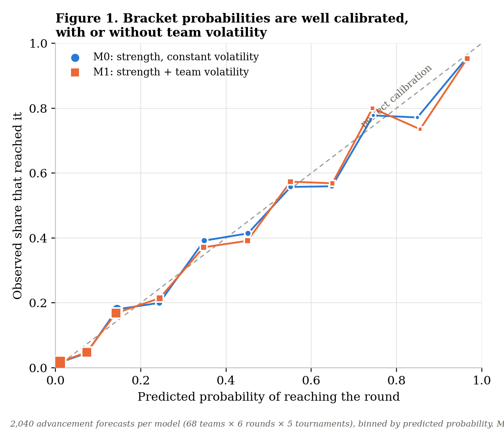
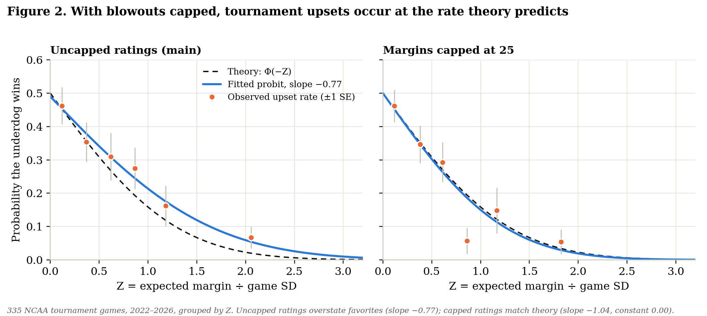
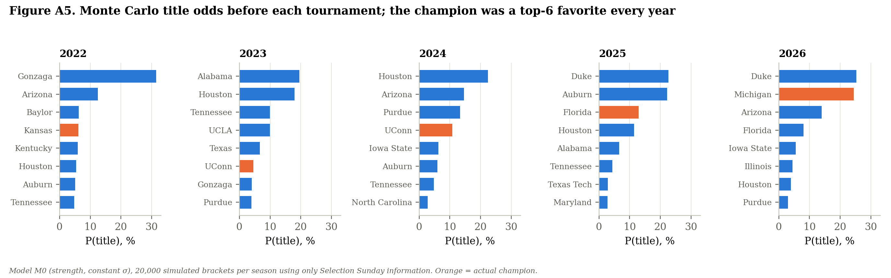

# Pricing the Madness

**Volatility, Strength, and NCAA Tournament Outcomes in the NIL Era (2021–22 to 2025–26)**

March Madness is famous for upsets; I wanted to know whether the "madness" is predictable. Borrowing an idea from options pricing, I treat every team as having a **strength** (its expected margin, like a stock's price) and a **volatility** (how much its results swing around that expectation). If volatile teams are the ones that pull off and suffer upsets, pricing that volatility should beat a model that treats every game as equally uncertain.

This repo has the full pipeline I built: it collects five seasons of public data, estimates team ratings and volatility, tests four hypotheses, and simulates 20,000 tournament brackets a season.

> 📄 **Paper:** coming soon in [`paper/`](paper/) &nbsp;·&nbsp; 📊 **All exhibits:** [`results/exhibits`](results/exhibits)

---

## Key Findings

| | Hypothesis | Result |
|---|---|---|
| **H1** | Team volatility is a stable trait | **Weak.** First-half vs. second-half volatility correlates at only r = 0.07; reliability ≈ 0.13 |
| **H2** | Playing style predicts volatility | **Supported.** More threes (taken and allowed), fewer free throws and a faster pace all raise volatility; the model passes RESET |
| **H3** | Volatile matchups produce more upsets | **Not supported.** Game volatility adds nothing once the expected margin is known (ΔAIC = 1.4 in favor of constant volatility) |
| **H4** | Volatility improves bracket forecasts | **Not supported.** Log loss: constant σ 0.554, team σ 0.559, style σ 0.554; an outside rating (TeamRankings) scores 0.548 |

**The Main Takeaway:** the madness is mostly a ratings problem, not a volatility problem. Tournament results look about 30% noisier than regular season ratings imply; however, when I cap regular season margins at 25 points, that excess disappears (the probit slope moves from −0.77 to −1.04, SE 0.22, against a theoretical −1.00). Blowouts against weak opponents inflate ratings, which makes favorites look safer than they are. In finance terms, the market was not mispricing volatility; it was mispricing the underlying.

<p align="center">
  
  
</p>
<p align="center">
  
</p>

---

## Method

1. **Ratings:** least-squares (Massey) ratings with home court advantage, a small ridge penalty and a sum-to-zero constraint, using only games played on or before Selection Sunday, so no tournament information leaks in.
2. **Volatility:** each game's squared residual is split between the two teams (E[e²] = v_home + v_away); team volatility = √(2v), shrunk toward the mean by n/(n+15).
3. **Win Probability:** a normal margin model, P(win) = Φ(μ/σ) (Stern, 1991); the same N(d₂) logic as Black–Scholes.
4. **H2:** pooled OLS on log volatility with season fixed effects and team-clustered standard errors; RESET, VIF, White and Doornik–Hansen diagnostics.
5. **H3:** probits on tournament upsets comparing constant and team-specific σ, plus a heteroskedastic probit (Harvey, 1976).
6. **H4:** 20,000 Monte Carlo brackets per season under each model, scored on log loss, Brier score and calibration.
7. **Robustness:** margins capped at 25 points; volatility shrinkage of 5 and 30 games ([`results/robustness_summary.csv`](results/robustness_summary.csv)).

**Data:** 27,857 regular season Division I games, 1,812 team seasons and 335 tournament games, 2022–2026. The econometrics were run in gretl; everything else is Python.

---

## Repo Layout

```
run_research.py        builds the research dataset, models and Monte Carlo
research.yaml          seasons, model settings (ridge, shrinkage, simulations, seed)
pipeline/research/     data.py (ratings + volatility), model.py, bracket.py (simulation)
analysis/              scripts that draw every table and figure in the paper
results/               exhibits (PNG), model scores and robustness summary
run.py, config.yaml    the live data feed for my Excel model (see docs/EXCEL_PIPELINE.md)
pipeline/sources/      fetchers for ESPN, TeamRankings and the KenPom front page
excel/                 VBA macros that import the feed into Excel on a Mac
tests/                 offline tests
```

## Reproduce It

Requires Python 3.10+.

```bash
python3 -m venv .venv && source .venv/bin/activate
pip install -r requirements.txt
python run_research.py                 # first run downloads ~5 seasons (about 15 min)
python analysis/make_exhibits.py       # tables and main figures -> results/exhibits
python analysis/make_appendix_figures.py
```

Robustness runs use the same script with overrides, for example:

```bash
python run_research.py --set model.margin_cap=25 --out output/robustness/cap25
python run_research.py --set model.shrink_games=5 --out output/robustness/shrink5
```

On a Mac you can also double-click `Setup (run once).command`, then `Build Research Data.command`.

## Data Note

All inputs come from public pages: ESPN's scoreboard feed, TeamRankings stat pages and the KenPom front page (no subscription data). Raw data is **not** included in this repo; the pipeline downloads it politely (rate limited and cached) for personal and academic use. Please respect each site's terms if you run it.

## Author

**Jack**, economics research project, 2026. Feedback is welcome; open an issue or reach out on LinkedIn.
